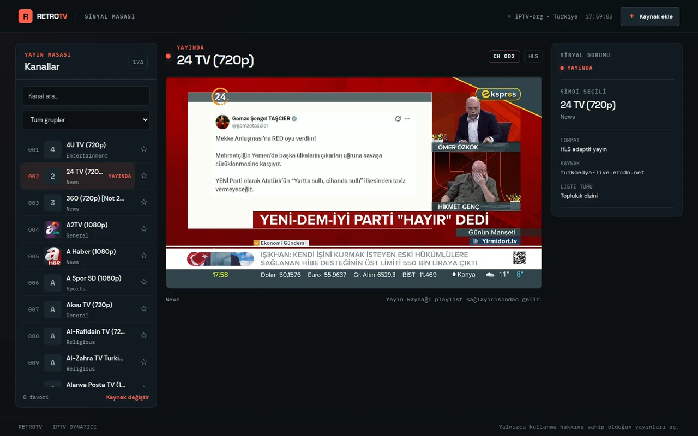
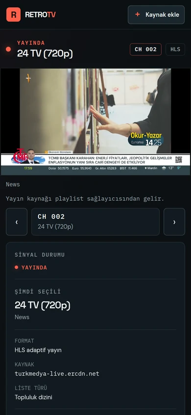
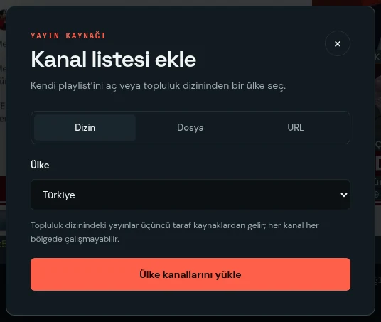

# RetroTV

A browser-only IPTV player for playlists you are authorized to use. Open an M3U file, an HTTPS playlist URL, or a country playlist from the optional IPTV-org community directory, then watch the channel.

**[Live demo →](https://selcukozdemir23.github.io/retrotv/)**



## Why it exists

RetroTV started as a TMDB browser. It could only show trailers, and the iframe host it depended on stopped resolving. Keeping a catalogue that could not play anything would have been a demo pretending to be a product, so it became a player for the thing it was named after: a broadcast desk where you pick a channel and watch it.

Everything runs in the browser. There is no server, no proxy, no account, and no bundled playlist. The playlist you load stays yours and stays on your machine.

## What it does

- Parses M3U names, groups, logos, and stream addresses in the browser
- Plays HLS through hls.js, or natively where the browser supports it
- Plays browser-compatible direct video sources
- Numbers every channel by its playlist position, so typing `024` jumps to it
- Filters by name and group, keeps favorites locally
- Says plainly why a stream will not play: CORS, mixed content, DRM, or a format the browser cannot decode

## Screenshots

 

## Technology

- Astro 7 static output
- Svelte 5 runes
- Tailwind CSS 4
- Vite 8
- hls.js, loaded lazily and only when a stream needs it
- `node:test` for the parser, with no test framework dependency

## Requirements

- Node.js 22.23.4 or newer
- npm
- A local M3U playlist, a CORS-enabled HTTPS playlist URL, or the optional IPTV-org directory

## Development

```sh
npm ci
npm run dev
```

The app never uploads a local playlist to a server. Remote playlist and video requests go directly from the browser to their respective sources. Remote servers must allow browser CORS requests, and a secure page can only play HTTPS streams. Do not share playlist URLs that contain credentials or signed query parameters.

## Keyboard

- Type a channel number (up to three digits) to jump to it; `Enter` confirms before the third digit
- `ArrowUp` / `ArrowDown` step through the playlist
- `Esc` closes the source dialog or cancels a half-typed channel number

The channel rail renders only the rows you can see, so a 15.000 channel playlist opens as fast as a 200 channel one.

## Quality checks

```sh
npm run check        # types and Astro diagnostics
npm test             # M3U parser unit tests (node:test)
npm run format:check # Prettier
npm run build
```

GitHub Actions runs all four before publishing to GitHub Pages.

## Project structure

```text
src/
├── components/IPTV/  # Channel rail, source dialog, player, and app shell
├── layouts/          # Astro document shell
├── lib/iptv/         # M3U parsing, source loading, and IPTV types
├── pages/            # Astro routes
└── styles/           # Global styles and signal-desk design tokens
tests/                # Parser unit tests
docs/
├── ARCHITECTURE.md   # Data flow, playback lifecycle, and source limits
├── ROADMAP.md        # Current priorities and follow-up work
└── screenshots/      # Screenshots used above
public/               # favicon, social card, robots.txt
```

## IPTV-org directory

RetroTV fetches the country index and a selected country playlist from the public [iptv-org API](https://github.com/iptv-org/api) and [iptv-org playlists](https://github.com/iptv-org/iptv). The directory is optional and its community-submitted streams are not guaranteed to work. RetroTV does not mirror or bundle the directory's stream list.

> IPTV-org entries are community-submitted stream links, not streams hosted by RetroTV. Availability, regional access, and rights vary by channel. Only open broadcasts you are authorized to watch. RetroTV does not bypass DRM, geo restrictions, or CORS.

See [the architecture notes](docs/ARCHITECTURE.md) for playback support and browser limitations.

## Deployment

The repository is configured for GitHub Pages under `/retrotv`. The deployment uses Node.js 22.23.4.

## License and attribution

RetroTV source code is licensed under MIT. IPTV-org data and stream links have their own source and legal notes; see the linked repositories before redistributing any data. RetroTV is not affiliated with IPTV-org or any broadcaster.
